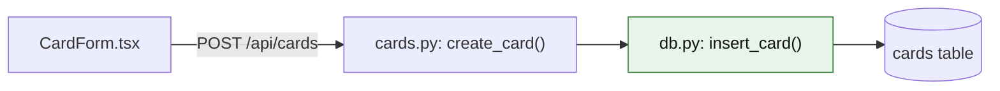

# xstack:map-the-flow

First read `${CLAUDE_PLUGIN_ROOT}/RULES.md`. If `docs/xstack/onboarding.md` is missing, run xstack:onboard first, then come back.

## Inputs
A feature name, a file, a user action ("creating a card"), or a bug handed over by xstack:error-detective.

## Step 1: Read before scanning
Read, if they exist:
- `docs/xstack/onboarding.md` (competency levels)
- `docs/xstack/features/<feature>/plan.md` and `flow-map.md`
- `docs/xstack/system-map.md` and the relevant `discovery/area-*.md`
Why: build on what is already known instead of re-scanning the codebase.

## Step 2: Staleness check
If a saved flow map exists, compare its recorded commit with `git rev-parse --short HEAD` and
`git diff --name-only <recorded>..HEAD`. If any file in the map changed, say which ones and ask:
**"Refresh this map? (main session, no subagents)"**. Never refresh silently.

## Step 3: Pick the map type
- **Traced**: existing code. Follow real calls with Grep and Read, starting from the entry point
  (UI event, route, CLI command, scheduled job) and ending where data is stored or returned.
- **Planned**: new code that does not exist yet. Draw the intended flow from `plan.md`, give every node the `planned` class (`(planned)` in the chat line).
- **Bug**: traced map plus the `err` class on the single node where the error surfaced.
  Never add the `cause` class. xstack:error-detective reveals the cause at Level 4.

## Step 4: Draw a small Mermaid map
Rules:
- `flowchart LR`, max 8 nodes. If the flow is bigger, save two maps in the same file: **Overview** (the main path)
  and **Zoom** (the part being worked on). Never one giant map.
- Node label: `file: function()` only, in quotes. For UI, `"CardForm.tsx"` is fine. Tables use `[( )]`.
- Short node ids (`form`, `create`, `insert`). Edge labels only for routes or events (`POST /api/cards`).
- Mark leaf pieces with the `leaf` class. A leaf is a small, self-contained piece with clear inputs and outputs
  (validation, formatting, one query, one handler). Size leaves by the user's competency in that area.
- No subgraphs, no extra styling. Markers are classes: `leaf`, `you`, `err`, `cause`, `planned`.
  Always paste the full classDef block below exactly (`color:#111` keeps text readable in dark theme).

Example:


Every file and function in the map must exist (Glob or Grep to confirm), except nodes with the `planned` class.

**In chat, never paste the Mermaid.** It does not render in the terminal. Show the one-line path, then where to open it:
```
CardForm.tsx → cards.py: create_card() → db.py: insert_card() (leaf) → cards table
Open docs/xstack/features/<feature>/flow-map.md, Ctrl+Shift+V (Cmd+Shift+V on Mac) to preview.
```
Chat markers: `(leaf)`, `(YOU)`, `✗` for err, `●` for cause, `(planned)`.

## Step 5: Explain, adapted to level
Ask with AskUserQuestion: **"You explain the flow, or Claude explains it?"**
(When called from xstack:leaf-task, this question is already in leaf-task's batched prompt. Do not ask twice.)
- **You explain:** the user walks the map in their own words. Reply with a card: what they nailed, any gaps, one-line correction.
- **Claude explains:** under the map, one line per node for beginner areas; just the map for confident areas.

## Step 6: Save
Write `docs/xstack/features/<feature>/flow-map.md` from `${CLAUDE_PLUGIN_ROOT}/templates/flow-map.md`:
map type, date, commit (`git rev-parse --short HEAD`, or `no-repo`), the Mermaid map (or Overview and Zoom), and the leaf list.
Bug maps are saved inside that bug's entry in `bugs.md` instead, not in `flow-map.md`.

## Step 7: Feature finished → update the system map
When the feature's `plan.md` checklist is fully checked, ask one line: **"Feature looks done, mark it finished?"**
On yes:
- Set the feature status to `done` in `plan.md`
- Add the feature's boxes and arrows to `docs/xstack/system-map.md` (Mermaid) automatically, no extra asking
- If it changed the schema or data shapes, update `docs/xstack/data-map.md` too
- Tell the user one line, like: "Added card due dates to the system map (3 new boxes)."
Why: a small edit from things already known, no subagents, and the big map only ever holds working features.
