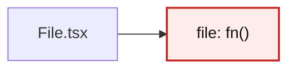

# Bugs: <feature>

## <bug-slug> (YYYY-MM-DD)
- **Symptom:** the error and what you saw
- **Bug map (as found):**

- **Expected / actual / repro:** (from Level 2)
- **What you tried:**
  - <attempt and what it showed>
- **Hint level reached:** 1 | 2 | 3 | 4 | answer given early (override)
- **Cause and why:**
- **Bug map (as solved):** added at Level 4, same map plus the cause class

- **Fix:** what changed, written by you | Claude
- **Lesson:** one line
