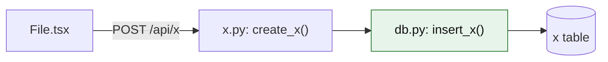

# Flow map: <feature>

- **Type:** traced | planned
- **Built:** YYYY-MM-DD at commit <short sha | no-repo>
- **Path:** File.tsx → x.py: create_x() → db.py: insert_x() (leaf) → x table

Preview with Ctrl+Shift+V (Cmd+Shift+V on Mac). Max 8 nodes; if bigger, use an Overview map and a Zoom map.

## Leaf pieces
- `file: function()`: inputs -> output
