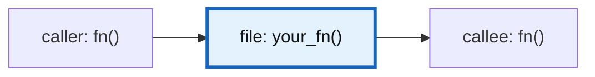

# Leaf task: <name>

- **Status:** open | done (YYYY-MM-DD)
- **Choices:** scaffolding: comments only | skeleton · tests: you | Claude | none · flow: you explained | Claude explained

## Goal
One line.

## Where
`file.py`, `function_name()`, around lines N to M (function name wins if lines drift).
Look for `TODO(xstack)` comments.

## Map


## Inputs / outputs
- **In:** name (type), example
- **Out:** type, example

## Spec checklist
- [ ] <what done means>
- [ ] <edge case handled>

## Hints
- <light nudge>
- <light nudge>

## Similar example (different context, adapt it, do not paste it)
```
<same concept, different names and domain>
```

## Tests
<who writes them, and test cases if Claude is writing them>
